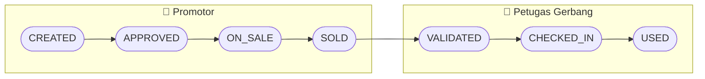
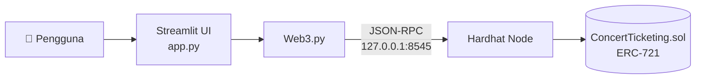

<div align="center">

# 🎫 ConcertChain

**Tiket konser NFT (ERC-721) yang transparan, aman, dan bisa diverifikasi di atas blockchain**


</div>

ConcertChain adalah aplikasi web untuk **menerbitkan, memiliki, mentransfer, dan memvalidasi tiket konser** berbasis NFT. Antarmuka dibuat dengan **Streamlit** dan terhubung ke smart contract `ConcertTicketing.sol` melalui **Web3.py**.

> ✅ Seluruh data tiket dibaca **langsung dari smart contract**, bukan data dummy.

Proyek ini adalah tugas **Praktikum Blockchain Modul 11–12 (Implementasi UI)**, Informatika UIN Siber Syekh Nurjati Cirebon, oleh **Kelompok 5**: Adrian, Bintang, dan Hafizh.

---

## 📑 Daftar Isi

- [Fitur dan Halaman](#-fitur-dan-halaman)
- [Peran dan Hak Akses](#-peran-dan-hak-akses)
- [Alur Status Tiket](#-alur-status-tiket)
- [Arsitektur](#-arsitektur)
- [Prasyarat](#-prasyarat)
- [Struktur Project](#-struktur-project)
- [Cara Menjalankan](#-cara-menjalankan)
- [Cara Penggunaan Singkat](#-cara-penggunaan-singkat)
- [Konfigurasi](#-konfigurasi)
- [Pemecahan Masalah](#-pemecahan-masalah)
- [Catatan](#-catatan)

---

## ✨ Fitur dan Halaman

Aplikasi memiliki 8 halaman. Kolom terakhir menunjukkan **hubungan tiap halaman dengan smart contract**.

| # | Halaman | Fungsi | Fungsi smart contract |
|---|---|---|---|
| 1 | 🏠 **Dashboard** | Ringkasan tiket, status koneksi blockchain, grafik alur status | `totalTickets`, `getTicket`, `name`, `symbol`, `promoter` |
| 2 | 🎪 **Daftar Tiket** | Daftar tiket (kartu dan tabel) dengan pencarian dan filter | `totalTickets`, `getTicket` |
| 3 | ➕ **Terbitkan Tiket** | Form penerbitan tiket baru dengan validasi (khusus promotor) | `createTicket` |
| 4 | 🔎 **Detail Tiket** | Detail berdasarkan ID, QR Code, metadata NFT, dan riwayat | `getTicket`, `getHistory` |
| 5 | 🎟️ **Tiket Saya & Transfer** | Tiket milik wallet aktif dan transfer kepemilikan | `getTicket`, `transferTicket` |
| 6 | 🔄 **Kelola Status** | Mengubah status tiket maju satu tahap oleh pihak berwenang | `updateStatus` |
| 7 | ✅ **Verifikasi Tiket** | Cek keabsahan: VALID / SUDAH DIPAKAI / BELUM VALID / INVALID | `getTicket` |
| 8 | 👛 **Wallet & Transaksi** | Alamat wallet, peran, saldo, status transaksi, dan administrasi petugas gerbang | `promoter`, `isGate`, `setGate` |

**Cara aplikasi berinteraksi dengan kontrak**

- **Membaca data** memakai pemanggilan fungsi *view* (`.call()`), tanpa biaya gas dan tanpa transaksi.
- **Menulis data** memakai transaksi (`.transact()`). Aplikasi mensimulasikannya lebih dulu agar alasan penolakan kontrak terbaca jelas, lalu menampilkan hasilnya: **menunggu konfirmasi, berhasil, atau ditolak**, lengkap dengan hash transaksi.

---

## 👥 Peran dan Hak Akses

| Peran | Hak akses |
|---|---|
| 🎤 **Promotor** (akun yang men-deploy kontrak) | Menerbitkan tiket, mengubah status ke `APPROVED`, `ON_SALE`, `SOLD`, serta menunjuk atau mencabut petugas gerbang |
| 🛂 **Petugas Gerbang** | Mengubah status ke `VALIDATED`, `CHECKED_IN`, `USED` |
| 🎫 **Pemilik tiket** | Memindahkan tiket ke wallet lain, selama belum `CHECKED_IN` |
| 👤 **Pengunjung** | Melihat data dan memverifikasi tiket |

Peran ditampilkan di sidebar di samping alamat wallet yang dipilih.

---

## 🔄 Alur Status Tiket

Status hanya bisa naik **satu tahap** pada satu waktu.



---

## 🏗️ Arsitektur



---

## 🧰 Prasyarat

| Kebutuhan | Keterangan |
|---|---|
| **Python** | 3.10 atau lebih baru |
| **Node.js dan npm** | Versi LTS, untuk Hardhat |
| **Git** | Untuk clone repositori |
| **Browser** | Chrome, Edge, atau Firefox |
| **Library Node.js** | Hardhat dan OpenZeppelin Contracts v5 (terpasang lewat `npm install`) |
| **Library Python** | `streamlit`, `web3` versi 6+, `pandas`, `qrcode[pil]` (terpasang lewat `requirements.txt`) |

Port yang dipakai: **8545** (Hardhat Node) dan **8501** (Streamlit).

---

## 📁 Struktur Project

```
.
├── app.py                      # Aplikasi Streamlit
├── deployment.json             # Alamat kontrak hasil deploy: {"address": "0x..."}
├── requirements.txt            # Dependensi Python
├── package.json                # Dependensi Node.js
├── hardhat.config.js           # Konfigurasi Hardhat
├── contracts/
│   └── ConcertTicketing.sol    # Smart contract
├── scripts/
│   └── deploy.js               # Skrip deploy
└── artifacts/
    └── contracts/
        └── ConcertTicketing.sol/
            └── ConcertTicketing.json   # ABI hasil compile
```

---

## 🚀 Cara Menjalankan

### 1. Clone repositori

```bash
git clone https://github.com/MuchmenAdrians/BlockChain_Kelompok-5.git
cd BlockChain_Kelompok-5/Tugas6
```

### 2. Install dependensi

```bash
# Node.js (Hardhat dan OpenZeppelin)
npm install

# Python
pip install -r requirements.txt
```

> 💡 Paket `qrcode[pil]` bersifat opsional. Tanpa paket ini aplikasi tetap berjalan, tetapi QR Code tidak ditampilkan.

### 3. Compile smart contract

```bash
npx hardhat compile
```

Perintah ini menghasilkan file ABI di folder `artifacts/`.

### 4. Jalankan Hardhat Node (terminal 1)

```bash
npx hardhat node
```

Biarkan terminal ini tetap berjalan. Node aktif di `http://127.0.0.1:8545` dan menyediakan 20 akun uji dengan saldo ETH.

### 5. Deploy smart contract (terminal 2)

```bash
npx hardhat run scripts/deploy.js --network localhost
```

Pastikan hasil deploy tersimpan di `deployment.json`:

```json
{ "address": "0xAlamatKontrakAnda" }
```

> Akun yang melakukan deploy otomatis menjadi **promotor**.

### 6. Jalankan aplikasi (terminal 3)

```bash
python -m streamlit run app.py
```

Jika perintah `streamlit run app.py` dapat dijalankan di komputer Anda, perintah itu juga bisa dipakai.

Aplikasi terbuka di **http://localhost:8501**.

---

## 🧭 Cara Penggunaan Singkat

1. Pilih **Wallet aktif** di sidebar. Peran (Promotor, Petugas Gerbang, Pengunjung) tampil di samping alamat.
2. Dengan akun promotor, buka **Terbitkan Tiket**, isi form, lalu kirim.
3. Di **Wallet & Transaksi**, promotor menunjuk akun lain sebagai petugas gerbang.
4. Di **Kelola Status**, ubah status tiket secara bertahap oleh pihak yang berwenang.
5. Di **Tiket Saya & Transfer**, pemilik memindahkan tiket ke wallet lain.
6. Di **Verifikasi Tiket**, masukkan ID tiket (dan wallet pemegang, opsional) untuk memeriksa keabsahan.

Setiap transaksi menampilkan hasilnya (menunggu konfirmasi, berhasil, atau ditolak beserta alasannya) dan tercatat di halaman **Wallet & Transaksi**.

<!--
## 🖼️ Tampilan Aplikasi
Tambahkan screenshot ke folder docs/screenshots/, lalu hapus tanda komentar ini.

| Dashboard | Daftar Tiket |
|---|---|
|  |  |

| Terbitkan Tiket | Detail Tiket |
|---|---|
|  |  |

## 🎬 Video Demo
Tautkan video demonstrasi di sini.
-->

---

## ⚙️ Konfigurasi

Pengaturan ada di bagian atas `app.py`:

| Variabel | Fungsi | Default |
|---|---|---|
| `RPC_URL` | Alamat node blockchain | `http://127.0.0.1:8545` |
| `DEPLOYMENT_PATH` | File alamat kontrak | `deployment.json` |
| `ARTIFACT_PATH` | File ABI hasil compile | `artifacts/contracts/ConcertTicketing.sol/ConcertTicketing.json` |

---

## 🛠️ Pemecahan Masalah

| Pesan error | Penyebab dan solusi |
|---|---|
| Tidak dapat terhubung ke Hardhat Network | Jalankan `npx hardhat node` terlebih dahulu |
| File deployment.json tidak ditemukan | Deploy smart contract terlebih dahulu |
| Artifact smart contract tidak ditemukan | Jalankan `npx hardhat compile` |
| Tidak ada kontrak di alamat pada deployment.json | Node di-restart sehingga kontrak hilang. Deploy ulang kontrak |
| Perintah `streamlit` tidak dapat dijalankan atau diblokir (misalnya oleh Windows Security) | Jalankan lewat Python: `python -m streamlit run app.py` |
| Transaksi ditolak kontrak | Wallet aktif tidak berwenang atau status tidak sesuai. Ganti wallet sesuai peran yang dibutuhkan |

---

## 📝 Catatan

- Kontrak **tidak memiliki fungsi pembayaran**, sehingga pembelian tiket disimulasikan sebagai transfer kepemilikan.
- Data pada blockchain lokal Hardhat **hilang saat node dihentikan**. Deploy ulang dan tunjuk kembali petugas gerbang setiap kali node dijalankan ulang.
- Wallet pada aplikasi adalah akun bawaan Hardhat (bukan MetaMask), sehingga cocok untuk pengujian dan demonstrasi lokal.

---

<div align="center">

Dibuat oleh **Kelompok 5**: Much. Mentari Adriansyah, Bintang Mutiara Arsy, dan Muh. Hafizh Abdul Karim · Informatika UINSSC

</div>